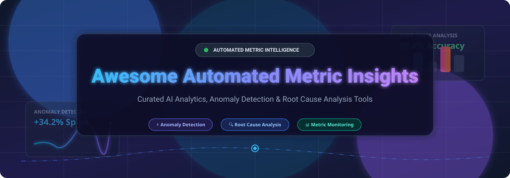

# Awesome-Automated-Metric-Insights

# Awesome-Automated-Metric-Insights 📊 🧠



  





  
  
  
  
  
  



---

## 🌟 Top Automated Metric Insights Ecosystem

**Curated List of Commercial AI Analytics Platforms & Open-Source Anomaly Detection Tools**  
*Focused on Automated Insight Generation, Anomaly Detection, Root Cause Analysis, Change Point Detection & Self-Hosted Metric Monitoring*

**Last updated: October 2026** 📅

---

### 📌 Overview & SEO Summary
Welcome to the ultimate curated directory of **automated metric insights platforms**, **open-source anomaly detection frameworks**, and **AI-powered analytics tools**. Whether you are looking for enterprise-grade commercial solutions (such as *Tableau Pulse*, *Sisu Data*, and *Anodot*), or self-hostable open-source alternatives (like *detectkit*, *OpenObserve*, and *Metabase*), this list covers category leaders, automated anomaly detection, and privacy-respecting metric intelligence.

**Key Market Context:**
- **ThoughtSpot SpotIQ** leverages machine learning and generative AI to automatically deliver personalized insights in seconds, with **Watchlists for monitoring critical business metrics**, **automated anomaly alerts**, **change analysis for root cause understanding**, and **forecasting capabilities** .
- **Tableau Pulse** provides **conversational exploration of metric groups** through **Tableau Agent in Pulse** (formerly Enhanced Q&A/Discover), with a **60-day free trial** for existing Tableau Cloud sites, and requires **Tableau+ license** for continued access after the trial .
- **Sisu Data** is the **Decision Intelligence Engine** that accelerates analysis by providing **fast, comprehensive, and actionable insights** on critical customer engagement and conversion metrics, enabling **deeper segmentation and automated activation pipelines** .
- **Tellius Feed** lets users **track metrics over time, set smart or threshold-based conditions, and receive automated alerts** with **visual insights attached** — including **intelligent ARIMA-based anomaly detection**, **breakdown by dimensions**, and **scheduled email notifications** .
- **Anodot** uses **30 ML models** to identify and resolve revenue, cost, and customer experience issues, with **correlated anomaly alerts**, **95% good catch rate**, and **slashing time to detection by up to 80%** without configuration .
- **Datadog Metric Monitors** support **anomaly detection** (using past behavior to detect abnormal patterns), **change alerts** (comparing absolute or relative change between N minutes ago and now), **outlier detection** (detecting when a group member diverges from the rest), and **forecast alerts** (predicting future metric behavior) .
- **Amplitude Automated Insights** replicates **an expert analyst's standard analysis process**, executing **chained tool calls** to investigate experiments, campaigns, and product releases — presenting **clear findings and recommendations with cited sources** .
- **detectkit** is a **Python library for time-series metric monitoring** with **automatic anomaly detection and alerting**, supporting **Z-Score, MAD, IQR detectors**, **seasonality handling**, **multi-channel alerting (Slack, Telegram, Email, Webhook)**, and **idempotent resume-from-interruption** .
- **OpenObserve Anomaly Detection** uses **Random Cut Forest (RCF)** with **100 random decision trees** on historical time series, **shingle size for context-aware scoring**, and **automatic seasonality detection** — trained in **under 60 seconds for 30 days of 5-minute data** .

---

## 📑 Table of Contents
- [🏢 SaaS & Commercial Platforms](#-saas--commercial-platforms)
- [🔓 Open-Source GitHub Projects](#-open-source-github-projects)
- [🛠️ How to Contribute](#%EF%B8%8F-how-to-contribute)
- [📊 Star History](#-star-history)
- [🤝 Support & Sponsorship](#-support--sponsorship)
- [⚠️ Disclaimer](#%EF%B8%8F-disclaimer)

---

## 🏢 SaaS / Commercial Platforms

The automated metric insights market spans **BI-native insight engines** (Tableau Pulse, ThoughtSpot SpotIQ) that embed **automated anomaly detection and change analysis into existing BI platforms**, **AI-native decision intelligence platforms** (Sisu, Tellius, Anodot) that were **built from the ground up for automated root cause analysis and metric monitoring**, and **product analytics platforms** (Amplitude, Mixpanel) that focus on **behavioral insights and user journey analysis**. **Tableau Agent in Pulse** requires **Tableau+ license** with a **60-day free trial** . **ThoughtSpot SpotIQ** uses **ML and generative AI** with **Watchlists and automated anomaly alerts** . **Anodot** achieves **95% good catch rate** with **30 ML models** .

| SaaS / Commercial Platform | Company / Owner | Valuation / Market Cap | Standard Edition Starting Price | Free Tier / Free Trial Limits | Description |
| :--- | :--- | :--- | :--- | :--- | :--- |
| **[Tableau Pulse](https://www.tableau.com/)** 📊 | Salesforce | ~$250 Billion | **Requires Tableau+** (custom pricing) | **60-day free trial for Tableau Agent in Pulse**  | **Enterprise BI with generative AI** — **Tableau Agent in Pulse for conversational metric exploration** . **Insight summaries and semantic matching included without Tableau+** . **Built on Salesforce Einstein Trust Layer with PII masking** . **Data never retained by LLM provider** . |
| **[ThoughtSpot SpotIQ](https://www.thoughtspot.com/)** 🔍 | ThoughtSpot | ~$4 Billion | **Custom enterprise pricing** | **Free trial available** | **Search-driven augmented analytics** — **Automated insight generation in seconds** using **ML and generative AI** . **Watchlists for monitoring critical metrics** with **automated anomaly alerts** . **Change analysis identifies root causes of KPI shifts** . **Forecasting with ML models** . **In-memory engine analyzes billions of rows in seconds** . |
| **[Sisu Data](https://sisu.ai/)** 📈 | Snowflake (Acquired) | ~$50 Billion (Snowflake) | **Custom enterprise pricing** | **No free tier** | **Decision Intelligence Engine** — **Accelerates analysis with AI/ML-powered analytics** . **Fast, comprehensive, and actionable insights on critical metrics** . **Analyzes 10M combinations and 162K columns** . **4M+ rows analyzed per second, 47B factor combinations tested** . **Used by Microsoft, Samsung, and Upwork** . |
| **[Tellius / Kaiya](https://www.tellius.com/)** 🧠 | Tellius | Private | **Custom enterprise pricing** | **Free trial available** | **AI-native decision intelligence** — **Feed lets users track metrics over time, set smart/threshold conditions, and receive automated alerts with visual insights** . **Intelligent (ARIMA) anomaly detection** . **Breakdown by dimensions to identify key segments** . **Scheduled email notifications with data refresh or custom cadence** . **Natural language search and automated insights** . |
| **[Anodot](https://www.anodot.com/)** 📉 | Anodot | Private | **Custom enterprise pricing** | **Free trial available** | **Autonomous business monitoring** — **30 ML models** identify revenue, cost, and customer experience issues . **95% good catch rate** with correlated anomaly alerts . **Slashing time to detection by up to 80%** without configuration . **Forecasts operational metrics and alerts if at risk** . **Real-time anomaly detection for e-commerce** . |
| **[Domo Stats](https://www.domo.com/)** 🟡 | Domo | ~$1 Billion | **Custom enterprise pricing** | **Free trial available** | **Business cloud with AI** — **AI Chat with @-mention context, multi-dataset analysis, and chart generation** . **FileSets for unstructured data** . **AI Agents in Workflows** . |
| **[Datadog Metric Alerts](https://www.datadoghq.com/)** 🐶 | Datadog Inc. | ~$40 Billion | **$15/host/month** (Infrastructure) | **14-day free trial** | **Full-stack observability with metric monitors** — **Anomaly detection using past behavior** . **Change alerts comparing absolute/relative change** . **Outlier detection for group divergence** . **Forecast alerts for trend prediction** . |
| **[Amplitude Insights](https://amplitude.com/)** 📊 | Amplitude | ~$1.5 Billion | **Custom pricing** | **Free tier available** | **Product analytics with automated insights** — **Replicates expert analyst's standard analysis process** with **chained tool calls** . **Investigates experiments, campaigns, and product releases** . **Presents clear findings and recommendations with cited sources** . |
| **[Outlier AI](https://outlier.ai/)** 🔴 | Outlier | Private | **Freelancer platform** (not metric insights) | **Free to join** | **AI training platform** — **Connects experts with AI companies to provide human feedback** . **Not a metric insights tool** — listed for category completeness. |
| **[Kinetica](https://www.kinetica.com/)** ⚡ | Kinetica | Private | **Custom enterprise pricing** | **Free trial available** | **Real-time analytics database** — **GPU-accelerated for extreme performance** . **Supports anomaly detection at scale** . |

---

## 🔓 Open-Source GitHub Projects

*Sorted by GitHub_Stars_Count (Descending)* 🌟

- **[Apache Superset](https://github.com/apache/superset)**   
  **The most complete open-source BI platform**, Apache-2.0 licensed. **40+ chart types, full SQL editor, and broadest warehouse coverage** — native connectors for Snowflake, BigQuery, Databricks, Redshift, Postgres, MySQL, Trino, ClickHouse, and 40+ more via SQLAlchemy . **Semantic layer** built around datasets and reusable metrics. **dbt manifest integration** . **Embedded SDK included free** — server issues guest token with RLS rules . **Stateless web tier scales horizontally** . **The default open-source answer for Tableau-class dashboarding and automated insights** . 🚀

- **[Grafana](https://github.com/grafana/grafana)**   
  **Operational monitoring and observability leader**, AGPL-3.0 licensed. **Default dashboard for Prometheus, InfluxDB, Elasticsearch, and dozens of time-series backends** . **Massive plugin ecosystem**, production-grade alerting, and large community . **Strong for real-time KPI monitoring** . **Grafana Cloud free tier** generous; paid from **$29/month** . **Integrates with OpenObserve and other anomaly detection backends** . 📈

- **[Metabase](https://github.com/metabase/metabase)**   
  **Most popular open-source BI by GitHub stars**, AGPL-3.0 licensed. **Single JAR file deployment** — `java -jar metabase.jar` and you have a BI tool . **Visual query builder** translates clicks into SQL for non-technical users . **OSS static embedding free** with "Powered by Metabase" badge; **Pro Interactive Embedding unlocks white-label, RLS, and SSO** . **Metaverse MCP server** enables **natural language alert setup** — "Notify me when any provider has more than 10 refunds in an hour" . 🎯

- **[detectkit](https://github.com/pipelab-dev/detectkit)**   
  **Metric monitoring with automatic anomaly detection**, open-source. **Pure numpy arrays — no pandas dependency in core logic** . **Statistical detectors: Z-Score, MAD, IQR, Manual Bounds** . **Trend & seasonality handling with seasonality grouping, recency weighting (half_life), and robust linear detrending for slowly drifting metrics** . **Multi-channel alerting: Mattermost, Slack, Telegram, Email, Webhook** . **@mentions — tag users/groups in alerts** . **Alert lifecycle: consecutive anomalies, cooldown, recovery notifications, no-data alerts** . **Database agnostic: ClickHouse, PostgreSQL, MySQL** . **Idempotent — resume from interruptions, no duplicate processing** . **AI-native onboarding with Claude Code context** . **The most complete open-source metric monitoring and anomaly detection library** . 🛠️

- **[OpenObserve](https://github.com/openobserve/openobserve)**   
  **Cloud-native observability platform with built-in anomaly detection**, Apache-2.0 licensed. **140x lower storage costs than Elasticsearch** . **Rust-based, single binary** . **RCF anomaly detection**: **100 random decision trees** on historical time series . **Shingle size for context-aware scoring** — catches gradual drifts, pattern breaks, and contextual anomalies . **Automatic seasonality detection** based on available history (day, week, or hour patterns) . **Training 30 days of 5-minute data (~8,640 points) completes in under 60 seconds** . **Model is 2–5 MB on S3** . **Each scored point carries _timestamp, actual_value, score, threshold_value, is_anomaly, deviation_percent, model_version** . **Why Rust**: no GC pauses corrupting timing-sensitive detection, compile-time thread safety, precise memory . 🌊

- **[OpenSearch Anomaly Detection](https://github.com/opensearch-project/anomaly-detection)**   
  **Anomaly detection plugin for OpenSearch**, Apache-2.0 licensed. **Fully open-source under the Linux Foundation** . **Log Pattern Analysis tool** (introduced 3.3.0) performs **advanced log analysis by detecting anomalous log patterns and sequences** through **comparative analysis between baseline and selection time ranges** . **Three analysis modes**: **Log sequence analysis** (trace-correlated), **Log pattern difference analysis** (frequency comparison), and **Log insights analysis** (error keyword detection) . **Uses ML clustering algorithms and statistical methods** to identify anomalous patterns that appear significantly more frequently in selection period . **Returns patterns with lift scores** — e.g., "ERROR Connection timeout" with base 0.02, selection 0.15, lift 7.5 . 🏛️

- **[Cube](https://github.com/cube-js/cube)**   
  **Semantic layer and API layer**, Apache-2.0 licensed. **Provides semantic layer, caching, and API layer** that sits between your data and any visualization tool . **Cube Cloud**: Free → Starter **$40/dev/mo** → Premium **$80/dev/mo** (Premium includes embedded dashboards) . **The strongest non-BI building block for productizing a dashboard offering** . 🧊

- **[Lightdash](https://github.com/lightdash/lightdash)**   
  **dbt-native BI platform**, open-source. **Reads your dbt project directly** — models, metrics, dimensions, descriptions become an explorable BI layer . **No re-defining metrics in a separate tool** . **First-class dbt awareness** . **Limitations**: not a standalone BI tool; chart builder lacks depth of Superset . **Lightdash Cloud starts free for small teams** . 🔧

- **[Knowage](https://github.com/KnowageLabs/Knowage-Server)**   
  **The most comprehensive open-source analytics and BI suite**, Apache-2.0 licensed. **Combines traditional and big data sources** into valuable information . **Full features: data exploration, preparation, self-service, ad-hoc reporting, mash-up, data/text mining, and advanced visualization** . **Smart Intelligence module** for interactive analysis with **R/Python embedding** for ML/DL models . **Function Catalog** for reusable analytical functions . **Community Edition free**, Enterprise Edition from Engineering Group . 🏛️

- **[Redash](https://github.com/getredash/redash)**   
  **SQL-first query and dashboard tool**, BSD-2-Clause licensed. **Does one thing**: write SQL, render charts, pin to dashboards . **Supports 35+ data sources** . **No visual query builder, no semantic layer** . **⚠️ Maintenance concern**: Databricks acquired Redash in 2020; development slowed dramatically . **Choosing Redash in 2026 is a bet on a project with unclear long-term maintenance** . ⚠️

- **[Evidence](https://github.com/evidence-dev/evidence)**   
  **Code-first analytics with Markdown**, MIT licensed. **Build dashboards by writing Markdown with embedded SQL** — Git-versioned, static-deployable . **No drag-and-drop for broad business users** . **$0 hosting** on Vercel/Netlify for static deploy . **Best for code-first analytics and embedded storytelling** . 📝

---

## 🛠️ How to Contribute

Contributions are welcome! Follow these steps to submit new automated metric insight platforms or open-source anomaly detection software:

1. 🍴 **Fork** the repository.
2. 📝 **Add/edit** entries in `README.md` maintaining table/list structure and formatting.
3. 🔗 Include project title, official website/GitHub link, exact Stars_Count, license, and brief description.
4. 🚀 Submit a **Pull Request** with a descriptive summary of your changes.

---

## 📊 Star History



---

## 🤝 Support & Sponsorship

If you find this automated metric insights repository useful, please consider supporting the project:

- ⭐ **Star** this repository to increase visibility!
- 🔀 **Fork** and share with fellow data analysts, product managers, and open-source advocates.
- ☕ **Sponsor & Buy Me a Coffee**: Support ongoing open-source curation via the [GitHub Sponsor Dashboard](https://github.com/sponsors/ishandutta2007).

---

## ⚠️ Disclaimer

- This is a **community-curated** list — not exhaustive and not an endorsement. ℹ️
- **Tableau Agent in Pulse requires Tableau+ license** after the **60-day free trial** — **insight summaries and semantic matching are available without Tableau+** . **ThoughtSpot SpotIQ uses ML and generative AI for automated insight generation in seconds** .
- **Anodot achieves 95% good catch rate with 30 ML models** and **slashes time to detection by up to 80% without configuration** . **Sisu analyzes 10M combinations and 162K columns** with **4M+ rows per second** .
- **Open-source metric monitoring tools are not turnkey** — **detectkit requires Python, database setup, and alert channel configuration** . **OpenObserve requires Rust binary deployment and S3 storage** . **OpenSearch Anomaly Detection requires OpenSearch cluster setup** .
- **Always validate anomaly detection accuracy and false positive rates with a proof-of-concept** before production deployment. Automated insights can produce misleading correlations — **verify findings against source data** before acting. 📊

---



  <b>Made with ❤️ for data analysts, product managers, and open-source metric insights advocates.</b>

